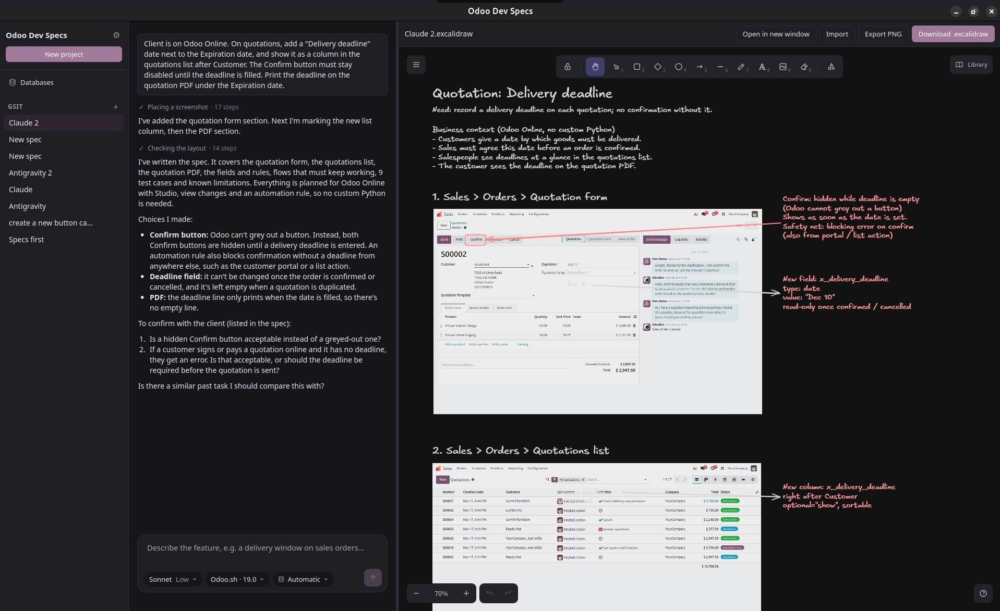
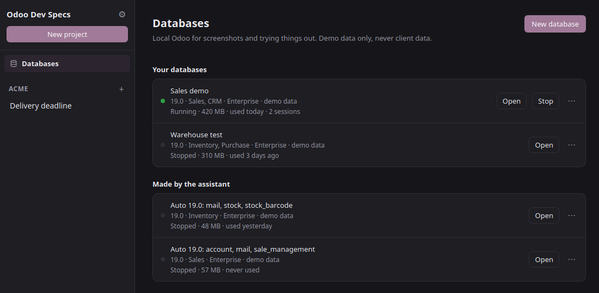

<p align="center">
  
</p>

<h1 align="center">Odoo Dev Specs</h1>

**Write Odoo development specs with an AI, on real Odoo screens.** Describe
what the client needs in a chat. The assistant reads the Odoo source, takes
screenshots of a local Odoo with demo data, and draws the spec for you in
Excalidraw: the real screens with the new fields, notes and arrows in red,
and the test cases. You check it, adjust it, and hand it to the tech team.

<p align="center">
  
</p>

Your client's data never goes to the AI. The screenshots come from Odoo
databases on your own computer, filled with Odoo's demo data.

## Features

- **Chat to a spec**: describe the feature in your own words; the assistant
  asks what is unclear, then draws the spec on the right while you watch.
- **The Odoo way first**: the assistant reads the Odoo source and looks for
  a setting, an access right, a standard module or report before proposing
  development. When something can't be done as asked on the client's
  hosting, it explains why in plain words and suggests the workaround before
  drawing.
- **Odoo Online or Odoo.sh, and the version**: each spec knows where the
  client's Odoo runs and its version (e.g. *Odoo Online · 19.2*). The
  assistant works only from that version's code, and the screenshots come
  from it.
- **Real Odoo screens**: screenshots of the exact form, list, button or PDF,
  with new fields shown where they will appear and red notes pointing at
  them.
- **Specs the tech team can use**: a short business context, one section per
  screen, and the test cases. No flow charts, no long texts.
- **Your choice of AI**: Claude Code or Antigravity (Gemini, Claude and
  other models), with the effort level for Claude.
- **Local Odoo databases**: create, open, stop, rename, copy, reset and
  delete them from the **Databases** page. Community or Enterprise, with the
  apps you choose and demo data.
- **One database per session**: pick one for each spec, or leave it on
  **Automatic**: the assistant uses a database of the right Odoo version, and
  makes one (`db-19-1`) only when there is none. Set a database up like your
  client, and the screenshots show it.
- **Edit by hand**: the diagram is a normal Excalidraw canvas. Change
  anything, open it in its own window, export a PNG or the `.excalidraw`
  file.
- **One-click setup**: the app installs what it needs and finds the Odoo
  source already on your computer (e.g. odev's worktrees), every version,
  and uses it where it is.
- **Odoo versions**: each spec uses its client's version. Versions can also be
  downloaded from GitHub in Settings, and are then kept up to date every week.
- **Updates from inside the app**: a new version is one click away.
- **Usage at a glance**: for Claude, your 5-hour and weekly limits under the
  message box.

<p align="center">
  
</p>

## Install

**You need:**

- Ubuntu 22.04 or 24.04, 64-bit, with admin rights (you type your password
  once during the setup).
- Odoo's source code on your computer, e.g. the worktrees odev makes. (Or
  download versions from GitHub in Settings; Enterprise needs a GitHub
  account with access.)
- An AI assistant installed on your computer: [Claude
  Code](https://code.claude.com/docs) or Antigravity.
- About 2 GB of free space for each Odoo version.

Then:

1. Go to the [latest release](../../releases/latest) and download the file
   ending in **`.deb`**.
2. Double-click it and choose **Install** in App Center. If App Center
   won't open it, run this in a terminal from your Downloads folder:
   ```bash
   sudo apt install ./odoo-dev-specs_*.deb
   ```
3. Open **Odoo Dev Specs** from your apps. The setup opens by itself.

### The first setup

<p align="center">
  
</p>

Click **Set up everything**:

1. **Tools**: Ubuntu asks for your password once. The app installs and
   starts what is missing (PostgreSQL, Python, Git, Chrome) and creates your
   database user.
2. **Odoo source**: the app shows the versions it found on your computer
   (odev's worktrees and the usual folders) and uses them where they are:
   nothing is downloaded and your folders are never changed. Nothing found?
   Click **Choose a folder…** and pick your Odoo folder.
3. **AI assistant**: click **Log in** if you are not logged in yet. A window
   opens for it.


Open the setup again any time from **Settings → General → Open setup**.

## Using it

1. **New project** in the sidebar for your client, then **+** for a new
   session (one per feature).
2. Choose where the client's Odoo runs under the message box: **Odoo
   Online** (the latest version is picked for you) or **Odoo.sh** and its
   version. New sessions of the same client start with the same choice.
3. Describe the feature in the chat, for example: *"On quotations, add a
   Delivery deadline date next to the Expiration date, and show it as a
   column in the quotations list."*
4. The assistant asks what is unclear. If part of it can't be done that way
   on the client's hosting, it tells you why and suggests the Odoo way;
   otherwise it draws the spec straight away. Edit it on the canvas, or ask
   the assistant to change it.

Under the message box:

| Chip | What it does |
|---|---|
| **Model** | Pick the AI service, then the model, and for Claude the effort (Low to Max). A session keeps the AI service of its first message. |
| **Hosting** | Where the client's Odoo runs and its version: *Odoo Online · 19.2* or *Odoo.sh · 19.0*. |
| **Database** | The Odoo database this session's screenshots use, of the session's version: **Automatic** (an existing one, or a new `db-19-1` if there is none), one of yours, or **New database…**. **Open** opens it in your browser (user `admin`, password `admin`). |

Under it, with Claude, your 5-hour and weekly limits; click them for when
they reset. (Antigravity doesn't publish its usage, so nothing shows there.)

The **Databases** page lists every local database with its version, apps,
edition, size and how many sessions use it. **New database** suggests a name
like `db-19-3`; **⋯** has Rename, Duplicate (copy it before an experiment),
Reset to fresh and Delete.

**Settings** (⚙ in the sidebar):

| Page | What you can change |
|---|---|
| **General** | The Odoo version and demo data for new databases, the diagram's theme (Light, Dark or System), and **Open setup**. |
| **Odoo versions** | The versions the app uses, with their size and last update: **Use a folder…** (e.g. your odev worktree), **Update now**, **Remove**, and download another version from GitHub (**Connect GitHub** first: one code to enter on github.com/login/device). |
| **AI services** | Which AI services are connected, and **Log in** for the others. |

## Updates

When a new version is out, a banner at the top says so. Click **What's new**
to see what changed, then **Update now**: Ubuntu asks for your password and
the app restarts on the new version.

To remove the app, run `sudo apt remove odoo-dev-specs`. Your specs stay in
`~/OdooSpecs`, and the Odoo sources and databases in
`~/.local/share/odoo-dev-specs` (delete the databases from the **Databases**
page first if you want them gone).

## Privacy

- **No customer data.** The screenshots come only from databases on your
  computer. There is no way to load a client's backup into the app.
- **What the AI sees**: your messages, the Odoo source code, and the
  screenshots of your local Odoo. It goes through your own Claude Code or
  Antigravity, as if you used them yourself.
- **What goes online besides the AI**: Chrome's download (Google), the app's
  update check (GitHub, at each start), and only if you download Odoo
  versions in Settings, the Odoo source (GitHub, over SSH with the app's own
  key, plus a weekly update of those versions).
- Your specs are plain files in `~/OdooSpecs/<Project>/<session>/`:
  `spec.excalidraw`, the screenshots, and the chat.

<details>
<summary><b>Build it yourself</b></summary>

You need Rust, Node.js 22 and Tauri's system libraries:

```bash
sudo apt install libwebkit2gtk-4.1-dev libsoup-3.0-dev libjavascriptcoregtk-4.1-dev \
  librsvg2-dev libxdo-dev libssl-dev libayatana-appindicator3-dev patchelf
cargo install tauri-cli --version "^2" --locked
```

```bash
make install    # UI dependencies
make dev        # run the app with live reload
make check      # format, lint, type check, unit and integration tests
make test-live  # end to end with the real Claude Code, Antigravity and Odoo (costs a few cents)
make build      # target/release/bundle/deb/*.deb
```

**CI/CD.** Every push and pull request runs `make check`. Every push to
`main` (or `master`) that passes is released automatically: the version goes
up by one patch (`0.1.4` → `0.1.5`), or put `[minor]` or `[major]` in a
commit message for a bigger step. The `.deb` is built on Ubuntu 22.04, so it
installs on 22.04 and 24.04. The release notes are the commit titles since
the last release, and they're what the app shows as "What's new".
</details>

<details>
<summary><b>How it works</b></summary>

| Path | What |
|---|---|
| `src-tauri/` | The desktop app (Rust): commands, the first-run setup, updates |
| `crates/specs-core/` | Sessions on disk, the AI CLIs (Claude Code, Antigravity), the spec-writing instructions (`claude/spec_skill.md`) |
| `crates/specs-mcp/` | The assistant's tools: drawing on the diagram, and Odoo screenshots with a map of what is on them, so notes point at fields by name |
| `crates/excalidraw/` | Reading and editing `.excalidraw` documents |
| `crates/odoo-runtime/` | Local Odoo: system checks and the install script, Odoo sources, Python environments, databases, servers |
| `ui/` | The interface (React + TypeScript): sidebar, chat, Excalidraw canvas, setup, Databases, Settings |

Odoo runs straight from its source with `odoo-bin`, one server per database,
on a free port; servers stop when the app closes. Everything lives in
`~/.local/share/odoo-dev-specs/runtime/`:

| Folder | What |
|---|---|
| `sources/repos/odoo`, `sources/repos/enterprise` | One shared Git repository per edition, like odev's, but holding only the latest commit of each version used (no history: a few hundred MB instead of 17 GB) |
| `sources/<version>/odoo`, `…/enterprise` | A worktree per version (`19.0`, `saas-19.2`…), or a link to a folder you chose |
| `venvs/<version>` | The version's Python environment |
| `ssh/` | The app's own SSH key, used only by the app's Git commands (your `~/.ssh` and its config are ignored) |
| `data/`, `state/` | Filestores; the running servers and the database list |

The app only lists or deletes PostgreSQL databases whose name starts with
`specs_`.

The assistant runs with read-only tools (read and search the Odoo source),
without your personal Claude settings or hooks, plus the diagram and
screenshot tools of the session.
</details>
