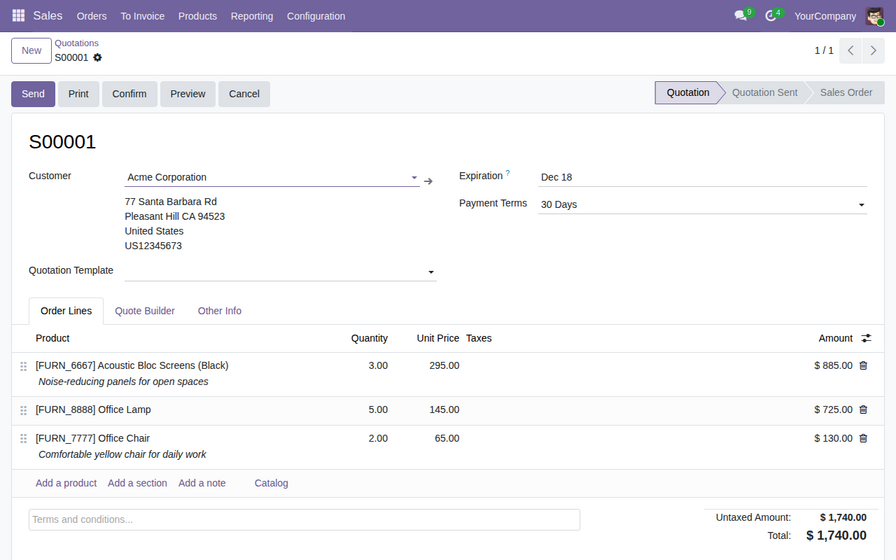
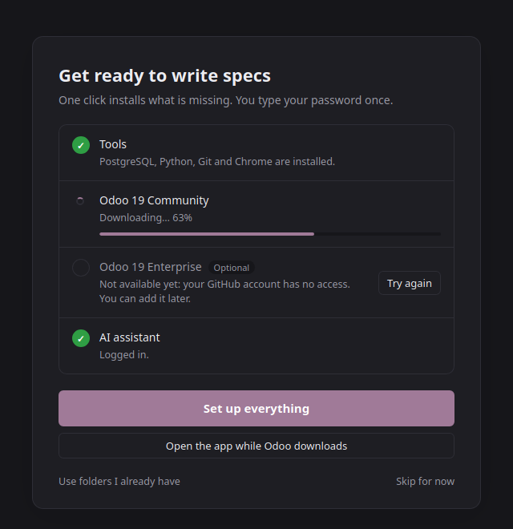

# Odoo Dev Specs

**Write Odoo development specs with an AI, on real Odoo screens.** Describe
what the client needs in a chat. The assistant reads the Odoo source, takes
screenshots of a local Odoo with demo data, and draws the spec for you in
Excalidraw: the real screens with the new fields, notes and arrows in red,
and the test cases. You check it, adjust it, and hand it to the tech team.

<p align="center">
  
</p>

Your client's data never goes to the AI. The screenshots come from Odoo
databases on your own computer, filled with Odoo's demo data.

## Features

- **Chat to a spec**: describe the feature in your own words; the assistant
  asks what is unclear, then draws the spec on the right while you watch.
- **Real Odoo screens**: screenshots of the exact form, list, button or PDF,
  with new fields shown where they will appear and red notes pointing at
  them.
- **Specs the tech team can use**: a short business context, one section per
  screen, and the test cases. No flow charts, no long texts.
- **Your choice of AI**: Claude Code or Antigravity (Gemini, Claude and
  other models), with the effort level for Claude.
- **Local Odoo databases**: create, open, stop, rename, copy, reset and
  delete them from the **Databases** page. Community or Enterprise, with the
  apps you choose and demo data.
- **One database per session**: each spec uses its own database, or
  **Auto** to let the assistant make a fresh one. Set the database up like
  your client, and the screenshots show it.
- **Edit by hand**: the diagram is a normal Excalidraw canvas. Change
  anything, open it in its own window, export a PNG or the `.excalidraw`
  file.
- **One-click setup**: the app installs what it needs and downloads Odoo by
  itself.
- **Updates from inside the app**: a new version is one click away.

<p align="center">
  
</p>

## Install

**You need:**

- Ubuntu 22.04 or 24.04, 64-bit, with admin rights (you type your password
  once during the setup).
- An AI assistant installed on your computer: [Claude
  Code](https://code.claude.com/docs) or Antigravity.
- About 2 GB of free space for each Odoo version.

Then:

1. Go to the [latest release](../../releases/latest) and download the file
   ending in **`.deb`**.
2. Double-click it and choose **Install** in App Center. If App Center
   won't open it, run this in a terminal from your Downloads folder:
   ```bash
   sudo apt install ./odoo-dev-specs_*.deb
   ```
3. Open **Odoo Dev Specs** from your apps. The setup opens by itself.

### The first setup

<p align="center">
  
</p>

Click **Set up everything**:

1. **Tools**: Ubuntu asks for your password once. The app installs and
   starts what is missing (PostgreSQL, Python, Git, GitHub's tool, Chrome)
   and creates your database user.
2. **Odoo 19 Community** downloads in the background (about 1.5 GB, a few
   minutes), then the app prepares it.
3. **Odoo 19 Enterprise** is optional. Click **Sign in to GitHub**: a
   window shows a short code to enter in your browser. If your GitHub
   account has no access to Odoo Enterprise yet, it says so; Community works
   without it, and you can click **Try again** once you have access.
4. **AI assistant**: click **Log in** if you are not logged in yet. A window
   opens for it.

You can start working while Odoo still downloads; a small ring in the
sidebar shows how far it is. Already have Odoo on your computer? Use
**Use folders I already have** instead of downloading it again.

Open the setup again any time from **Settings → General → Open setup**.

## Using it

1. **New project** in the sidebar for your client, then **+** for a new
   session (one per feature).
2. Describe the feature in the chat, for example: *"Client is on Odoo
   Online. On quotations, add a Delivery deadline date next to the
   Expiration date, and show it as a column in the quotations list."*
3. The assistant asks what is unclear, then draws the spec. Edit it on the
   canvas, or ask the assistant to change it.

Under the message box:

| Chip | What it does |
|---|---|
| **Model** | Pick the AI service, then the model, and for Claude the effort (Low to Max). A session keeps the AI service of its first message. |
| **Database** | The Odoo database this session's screenshots use: **Auto**, one of yours, or **New database…**. **Open** opens it in your browser (user `admin`, password `admin`). |

The **Databases** page lists every local database with its version, apps,
edition, size and how many sessions use it. **New database** suggests a name
like `db-19-3`; **⋯** has Rename, Duplicate (copy it before an experiment),
Reset to fresh and Delete.

**Settings** (⚙ in the sidebar):

| Page | What you can change |
|---|---|
| **General** | The Odoo version and demo data for new databases, the diagram's theme (Light, Dark or System), and **Open setup**. |
| **AI services** | Which AI services are connected, and **Log in** for the others. |

## Updates

When a new version is out, a banner at the top says so. Click **What's new**
to see what changed, then **Update now**: Ubuntu asks for your password and
the app restarts on the new version.

To remove the app, run `sudo apt remove odoo-dev-specs`. Your specs stay in
`~/OdooSpecs`, and the Odoo sources and databases in
`~/.local/share/odoo-dev-specs` (delete the databases from the **Databases**
page first if you want them gone).

## Privacy

- **No customer data.** The screenshots come only from databases on your
  computer. There is no way to load a client's backup into the app.
- **What the AI sees**: your messages, the Odoo source code, and the
  screenshots of your local Odoo. It goes through your own Claude Code or
  Antigravity, as if you used them yourself.
- **What goes online besides the AI**: the Odoo source download (GitHub),
  Chrome's download (Google), and the update check (GitHub, at each start).
- Your specs are plain files in `~/OdooSpecs/<Project>/<session>/`:
  `spec.excalidraw`, the screenshots, and the chat.

<details>
<summary><b>Build it yourself</b></summary>

You need Rust, Node.js 22 and Tauri's system libraries:

```bash
sudo apt install libwebkit2gtk-4.1-dev libsoup-3.0-dev libjavascriptcoregtk-4.1-dev \
  librsvg2-dev libxdo-dev libssl-dev libayatana-appindicator3-dev patchelf
cargo install tauri-cli --version "^2" --locked
```

```bash
make install    # UI dependencies
make dev        # run the app with live reload
make check      # format, lint, type check, unit and integration tests
make test-live  # end to end with the real Claude Code, Antigravity and Odoo (costs a few cents)
make build      # target/release/bundle/deb/*.deb
```

**CI/CD.** Every push and pull request runs `make check`. Every push to
`main` (or `master`) that passes is released automatically: the version goes
up by one patch (`0.1.4` → `0.1.5`), or put `[minor]` or `[major]` in a
commit message for a bigger step. The `.deb` is built on Ubuntu 22.04, so it
installs on 22.04 and 24.04. The release notes are the commit titles since
the last release, and they're what the app shows as "What's new".
</details>

<details>
<summary><b>How it works</b></summary>

| Path | What |
|---|---|
| `src-tauri/` | The desktop app (Rust): commands, the first-run setup, updates |
| `crates/specs-core/` | Sessions on disk, the AI CLIs (Claude Code, Antigravity), the spec-writing instructions (`claude/spec_skill.md`) |
| `crates/specs-mcp/` | The assistant's tools: drawing on the diagram, and Odoo screenshots with a map of what is on them, so notes point at fields by name |
| `crates/excalidraw/` | Reading and editing `.excalidraw` documents |
| `crates/odoo-runtime/` | Local Odoo: system checks and the install script, Odoo sources, Python environments, databases, servers |
| `ui/` | The interface (React + TypeScript): sidebar, chat, Excalidraw canvas, setup, Databases, Settings |

Odoo runs straight from its source with `odoo-bin`, one server per database,
on a free port; servers stop when the app closes. Everything lives in
`~/.local/share/odoo-dev-specs/runtime/` (`sources/<version>/odoo` and
`enterprise`, `venvs/<version>`, `data/` for filestores, `state/` for the
running servers and the database list). The app only lists or deletes
PostgreSQL databases whose name starts with `specs_`.

The assistant runs with read-only tools (read and search the Odoo source),
without your personal Claude settings or hooks, plus the diagram and
screenshot tools of the session.
</details>
